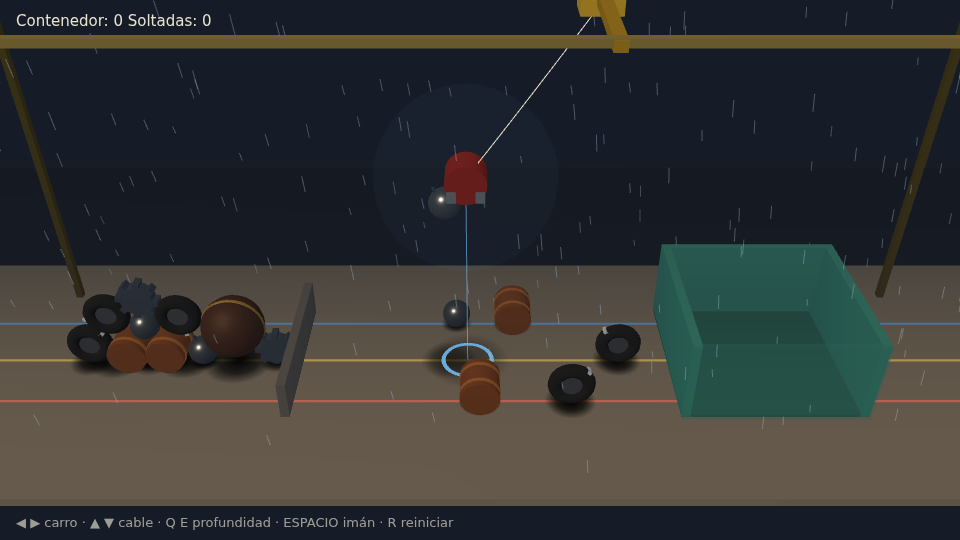

# Crane in the Storm

*Grúa en la tormenta.* A small physics prototype about a scrapyard crane, a magnet on a swinging cable, and a storm that will not leave you alone.



Pick up scrap (tires, barrels, gears, balls, one very heavy block) and drop it into the container on the right. The cable swings, the wind pushes, and the three-quarter view means you also have to line up in depth before the magnet can grab anything.

**Status: prototype.** It runs, it is playable, the physics is mine, and the core loop works. It is not balanced, it has no levels yet, and nobody has tested a long session. See [Known limits](#known-limits).

## Play

Open `index.html` in a desktop browser. No install, no server. A hosted version can be served from GitHub Pages.

| Key | Action |
| --- | --- |
| Left / Right (or A / D) | Move the trolley |
| Up / Down (or W / S) | Lower or raise the cable |
| Q / E | Move the trolley in depth (three lanes) |
| Space | Magnet on / off |
| R | Restart |

Tip: the piece the magnet would grab is highlighted, and a blue ring on the ground shows where the magnet is aligned.

## What is in here

- `index.html`: the game, one self-contained file (Three.js bundled in).
- `src/`: the game logic (`main_stage2.js`, own physics, no engine) and the Three.js scene (`render.js`).
- `2d/index.html`: the first 2D prototype, kept for comparison.
- `test/`: headless browser checks (`clean.js` checks lane alignment and drops, `real.js` plays a real keyboard cycle).
- `docs/`: screenshots.

## Build and test

```
npm install
npm run build     # rebuilds index.html from src/
npm test          # needs Chrome; set CHROME=/path/to/chrome if it is not at /usr/bin/google-chrome
```

Tests use software rendering, so they are slow. `real.js` in particular can take a couple of minutes.

## Design notes

- **Own physics.** Circles and boxes, sub-stepped, a rope as a chain of constraints, and a magnet that holds with a limited grip per object. Heavy things slip.
- **Depth lanes.** Objects sit on three lanes (z = -70, 0, 70). The magnet only grabs if you are aligned in depth, so Q/E matter. The ring and the highlight exist because early tests showed that misalignment felt like a bug, not a rule.
- **2D first.** The prototype started flat. The three-quarter view came after, because depth is part of the game.

## Known limits

- In-game hint text is in Spanish. There is no English toggle yet.
- Desktop and keyboard only. No touch controls.
- Sound has not been judged by ear. Frame rate has only been measured on software rendering, not on a GPU.
- No levels, no win state beyond the container counter.
- In one hosted preview (an auto-resizing iframe), the canvas went black after scrolling the page. The game itself renders fine. The cause is not found and is not fixed. If you see it, open `index.html` directly.

## License

Code, including the game that runs from `index.html`: MIT, see [LICENSE](LICENSE). Cover art and screenshots in this repo: CC BY-NC-SA 4.0. Three.js is MIT, copyright its authors (version 0.187.0, bundled in `index.html`).
